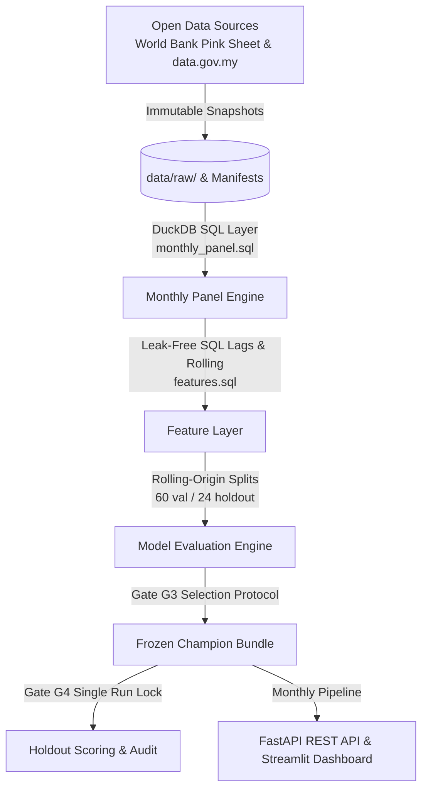

# PalmGuard: Malaysian Commodity Forecasting Engine

[](https://github.com/luqshzeeq3601-art/08_PalmGuard_Malaysian_Commodity_Forecasting/actions/workflows/ci.yml)
[](LICENSE)
[](https://www.python.org/downloads/release/python-3110/)
[](https://creativecommons.org/licenses/by/4.0/)

> [!IMPORTANT]
> **Mandatory Disclaimers & Benchmark Specification**:
> 1. **Forecasting Demonstrator**: PalmGuard is a research and forecasting demonstrator. It is NOT trading, investment, hedging, or procurement advice.
> 2. **No Financial Benefit Measured**: No monetary savings, excess returns, or portfolio alpha were evaluated or claimed.
> 3. **Empirical Intervals**: Prediction interval coverage is measured empirically on historical data and is NOT guaranteed for future distributions.
> 4. **Target Specification**: The primary palm oil series is derived from the **World Bank Commodity Price Data (Pink Sheet)** converted to MYR/mt with Bank Negara Malaysia (BNM) monthly mean exchange rates. It reflects predominantly refined (RBD) Malaysian palm oil with documented delivery basis splices. **It is NOT the physical delivered Crude Palm Oil (CPO) price published by the Malaysian Palm Oil Board (MPOB)**.

---

## 1. Overview & Architecture

PalmGuard is an end-to-end forecasting pipeline engineered for Malaysian commodity benchmarks and producer price indices, designed with strict data provenance, DuckDB SQL feature engineering, conformal prediction uncertainty bands, and reproducible evaluation gates.



---

## 2. Measured Results & Scientific Findings

All numbers below trace directly to audited artifacts in [`reports/holdout_metrics.csv`](reports/holdout_metrics.csv) and [`reports/validation_metrics.csv`](reports/validation_metrics.csv).

### Champion Selection (Checkpoint Gate G3)
- **`palm_wb_myr` Champion: B1 (Naive)**
  - Candidate B1 validation pooled MASE was 3.0992 vs best candidate B4 ARIMA (3.0606).
  - The relative gap was **1.26%**, within the **2.0% tie threshold** declared in `05_FORECAST_EXPERIMENT_PLAN.md`. Per the simplicity tie-breaking rule, B1 Naive won champion status.
- **`ppi_oilsfats_my` Champion: B3 (ETS)**
  - Candidate B3 won outright with the lowest pooled validation MASE of **1.1900** (WAPE 0.0205).

### Final Holdout Evaluation (Checkpoint Gate G4 — 24 Rolling Origins)

| Target Series | Champion | Horizon | n | MASE | WAPE | RMSE | MAE | Bias |
| :--- | :--- | :--- | :--- | :--- | :--- | :--- | :--- | :--- |
| **`palm_wb_myr`** (RM/mt) | **B1 (Naive)** | h=1 | 23 | 1.1581 | 0.0394 | 249.53 | 176.54 | -7.62 |
| | | h=2 | 22 | 1.9093 | 0.0654 | 375.89 | 291.13 | 18.41 |
| | | h=3 | 21 | 2.3456 | 0.0811 | 426.97 | 357.70 | 51.81 |
| | | **Pooled** | 66 | **1.7868** | **0.0612** | **356.09** | **272.38** | **19.97** |
| **`ppi_oilsfats_my`** (Index) | **B3 (ETS)** | h=1 | 23 | 0.8100 | 0.0123 | 2.07 | 1.61 | -0.21 |
| | | h=2 | 22 | 1.8415 | 0.0278 | 4.29 | 3.66 | -0.41 |
| | | h=3 | 21 | 2.8807 | 0.0434 | 6.74 | 5.72 | -0.66 |
| | | **Pooled** | 66 | **1.8133** | **0.0274** | **4.70** | **3.60** | **-0.42** |

### Key Empirical Findings & Hypothesis Audit
- **Objective O2 (Hypothesis: Champion MASE $\le 0.95$ at $h=1$ on Validation)**:
  - `palm_wb_myr`: **MISSED** (Validation $h=1$ MASE was 2.0131). Palm oil monthly spot prices behave as a near-martingale where past level persistence is optimal; gradient-boosted trees and macro drivers suffered from sample variance and overfit.
  - `ppi_oilsfats_my`: **MET** (Validation $h=1$ MASE was 0.5515).
- **Objective O3 (Conformal Calibration, validation coverage within ±5 pp of nominal)**: **MISSED** on both series. Interval method C2 (adaptive conformal) was selected on validation. Largest validation gap from nominal: `palm_wb_myr` 6.7 pp, `ppi_oilsfats_my` 9.6 pp, against a ±5 pp target. On the holdout, palm oil coverage was 77% to 83% at the 80% level; PPI bands were too narrow (59% to 70% at the 80% level). Full table: `reports/validation_coverage.csv`, `reports/holdout_coverage.csv`.

---

## 3. Quickstart & CLI Commands

### Installation
```bash
git clone https://github.com/luqshzeeq3601-art/08_PalmGuard_Malaysian_Commodity_Forecasting.git
cd 08_PalmGuard_Malaysian_Commodity_Forecasting
python -m venv .venv
source .venv/bin/activate  # On Windows: .venv\Scripts\activate
pip install -r requirements.lock.txt
pip install -e ".[dev]"
```

### Verification & Operations
```bash
# 1. Run environment diagnostics (Gate G0)
palmguard doctor

# 2. Run automated test suite
pytest

# 3. Execute full forecasting pipeline (Gate G5)
palmguard pipeline run --offline

# 4. View published forecasts and uncertainty bands
palmguard forecast

# 5. Check data drift and monitoring alerts
palmguard monitor
```

---

## 4. Serving: API & Interactive Dashboard

### FastAPI REST Service
```bash
uvicorn palmguard.api:app --host 0.0.0.0 --port 8000
# Endpoints:
# - GET /health     (Liveness probe)
# - GET /ready      (Readiness probe & model metadata)
# - GET /forecast   (Latest forecasts with 80% and 90% conformal bands)
# - GET /history    (Historical forecasts, actuals, and error metrics)
# - GET /monitoring (Rolling MASE/coverage & PSI/KS drift flags)
```

Run the automated API smoke test:
```bash
python scripts/smoke_api.py --base-url http://localhost:8000
```

### Streamlit Dashboard
```bash
streamlit run dashboard/app.py
```

---

## 5. Deployment & Containerization

A production multi-stage Docker container is provided:
```bash
docker build -t palmguard:latest .
docker run -p 8000:8000 palmguard:latest
```
Deployment status: CI (tests, Docker build, container smoke test) and the pipeline workflow run on GitHub Actions. The API and dashboard are **not deployed to a public URL yet**.
- **API**: Configured for Render free-tier via [`render.yaml`](render.yaml).
- **Dashboard**: Runs locally; intended for Streamlit Community Cloud.
- **Scheduled Pipeline**: GitHub Actions monthly refresh on the 8th via [`.github/workflows/pipeline.yml`](.github/workflows/pipeline.yml).

---

## 6. Open Data Attribution & Licensing

PalmGuard exclusively consumes Creative Commons Attribution 4.0 International (CC BY 4.0) data:
- **World Bank Commodity Markets (Pink Sheet)**: `https://www.worldbank.org/en/research/commodity-markets`
- **Bank Negara Malaysia (BNM)** Daily exchange rates: `https://data.gov.my`
- **Department of Statistics Malaysia (DOSM)** OpenDOSM / `data.gov.my`
