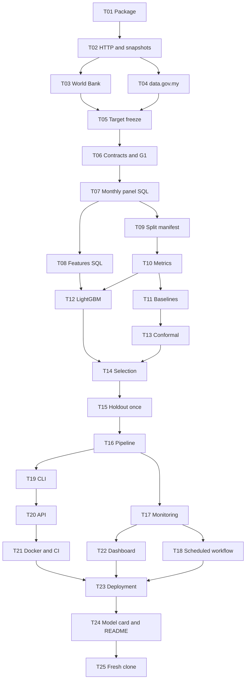

# PalmGuard implementation plan

Status: DRAFT, 2026-10-11. Implementation has not started and needs explicit approval.

## 1. Delivery approach

Build a thin, valid slice in dependency order: data with provenance, leak-free SQL features, baselines, then LightGBM and intervals, then the pipeline and deployment. `tasks/todo.md` is the only status tracker.

Working estimate: **45-60 focused hours**. No fixed deadline.

## 2. Milestones

| Phase | Tasks | Effort | Outcome / exit gate |
| --- | --- | --- | --- |
| A: foundation | T01-T02 | 5-7 h | Locked package, HTTP client, snapshot store; G0 |
| B: data | T03-T06 | 7-9 h | World Bank and data.gov.my ingested with manifests, target definition frozen, quality report; G1 |
| C: features and splits | T07-T09 | 6-8 h | SQL feature layer with leakage tests, frozen split manifest; G2 |
| D: models and evaluation | T10-T15 | 12-15 h | Baselines, LightGBM, intervals, selection record, holdout scored once; G3/G4 |
| E: pipeline and monitoring | T16-T18 | 6-8 h | Idempotent pipeline, drift check, scheduled workflow; G5 |
| F: delivery | T19-T23 | 6-8 h | CLI, API, Docker/CI, dashboard, public deployment; G6 |
| G: release | T24-T25 | 3-4 h | Model card, README with measured results, fresh-clone proof; G7 |

## 3. Gates

| Gate | Passes when |
| --- | --- |
| G0 | Package installs from the lock file; `palmguard doctor` passes |
| G1 | O1 met; target definition (World Bank palm oil in MYR, or the PPI fallback) frozen in the decisions log |
| G2 | O4 leakage and vintage tests pass; split manifest frozen |
| G3 | Validation report complete; selection record written |
| G4 | Holdout scored once; results reported against O2 and O3 |
| G5 | Pipeline idempotent on fixtures; a manual workflow dispatch publishes |
| G6 | CI green including container smoke test; public URLs pass the smoke test |
| G7 | Fresh clone reproduces tests and the fixture pipeline; O5 evidence logged or its pending status stated |

## 4. Risk register

| ID | Risk | Impact | Mitigation |
| --- | --- | --- | --- |
| R1 | Target is not the MPOB CPO price; it may be refined palm oil and its basis changed over time | High | Definition confirmed from the file in T03; stated on every surface; project never claims an MPOB price |
| R2 | Pink Sheet palm oil column unverified in the file | High | T03 reads the file first; fallback target is PPI section 4 with the shorter split |
| R3 | Pink Sheet link, layout or schedule changes | Medium | Link resolved from the landing page; contract check stops the run; last good publication stays live; weekly live contract test |
| R4 | data.gov.my limit of 4 requests/minute, no SLA | Medium | Throttle, backoff, parquet backfill, few calls per run |
| R5 | Revisions change history | High | Dated snapshots, vintage IDs, revisions log |
| R6 | ML does not beat naive | Medium | Naive may be champion; reported plainly |
| R7 | Small sample (about 300 rows, 24 holdout points) | Medium | Small grid; uncertainty stated |
| R8 | Reported definition change in January 2021 falls inside the sample | Medium | Break dated from the file, shown on the dashboard, series not adjusted; holdout lies after it |
| R15 | PPI series has only 200 months | Medium | Shorter split (96/48/24); reported separately; wider uncertainty stated |
| R9 | Free hosting limits and cold starts | Low | Documented; smoke test tolerates a cold start; terms rechecked at T23 |
| R10 | Cloud Run on the portfolio checklist is not delivered | Medium | Script included, marked unverified; needs billing to verify |
| R11 | Accounts for the schedule and hosting | Low | Public GitHub repo with default token only; Render and Streamlit accounts; GitHub disables cron after 60 idle days |
| R12 | Monthly cadence: live evidence accrues slowly | Low | Backtest and live scores labelled separately |
| R13 | Backtests cannot use true historical vintages | Medium | Stated in model card; live runs are vintage-correct |
| R14 | Holdout leakage through repeated experiments | High | Selection record before holdout; single-run guard |

## 5. Open questions for the user

| ID | Question | Needed by |
| --- | --- | --- |
| Q1 | Will you create the Render and Streamlit Community Cloud accounts, or should the plan stop at a local container? | T23 |
| Q2 | Should Cloud Run be verified later with a billing-enabled project? | After T25 |

Resolved 2026-10-11: MPOB removed, so no permission email and no private data repository.
Resolved 2026-10-12 (Q3): Keep folder name `Malaysian_Commodity_Forecasting` and use `palm_wb_myr` described as "Malaysian palm oil price (World Bank Pink Sheet, MYR/mt)" as the headline target alongside `ppi_oilsfats_my`.

## 6. Stop condition

v0.1 is complete when G0 to G7 pass and the README reports measured results. More models, daily data or a paid cloud deployment need a new task scope.
